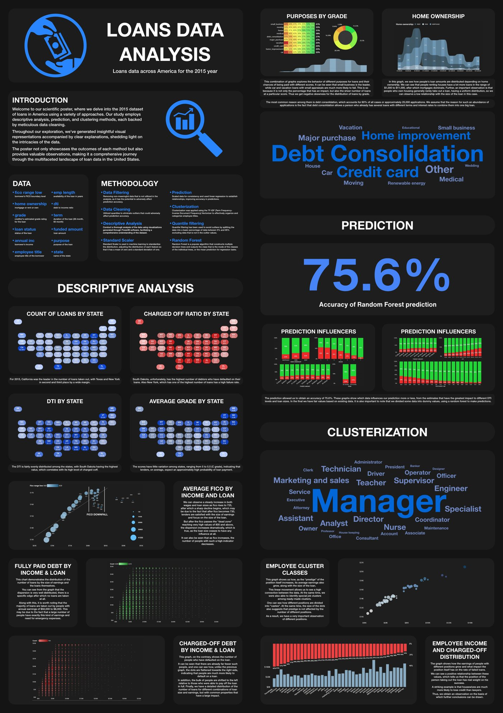
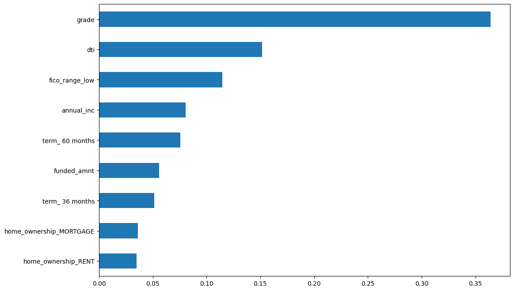
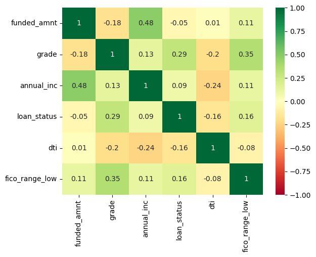

# Loans Data Analysis: US Loans in 2015

Exploratory analysis of 2015 US consumer loan data, combining data cleaning, descriptive visual analysis in Power BI, loan repayment prediction with a Random Forest, and TF-IDF + k-means clustering of borrowers' job titles. The results were presented as a scientific poster.

## What the project does

1. **Data cleaning** – drops non-informative columns, maps categorical values (grades, employment length, US states) to usable forms, reduces memory use from ~227 MB to ~89 MB through data types, and removes outliers (quantile filtering on annual income, DTI < 41).
2. **Descriptive analysis** – distributions and relationships between loan amount, income, FICO score, grade, purpose, home ownership and state, visualised in Power BI (state maps, scatter plots, word clouds). See [`poster/descriptive_graphs.pdf`](poster/descriptive_graphs.pdf).
3. **Repayment prediction** – a scikit-learn `RandomForestClassifier` (max depth 10) trained on standardised, one-hot-encoded features, evaluated with stratified 5-fold cross-validation and a held-out 30% test set.
4. **Model interpretation** – feature importances from the forest identify the variables that matter most: loan grade, debt-to-income ratio, FICO score, annual income and loan term.
5. **Job-title clustering** – free-text employee titles are cleaned, vectorised with TF-IDF and grouped with k-means, then refined manually into ~40 occupation clusters (managers, nurses, engineers, owners…), which are linked back to income and charged-off rates.

## Prediction results

| Feature importance | Correlation matrix |
|---|---|
|  |  |

- Cross-validated accuracy ≈ 0.75; held-out test accuracy ≈ 0.76.
- **Note on class imbalance:** about 74% of completed loans are fully paid, so always predicting "Fully Paid" would already reach ~74% accuracy. The model is strong at recognising loans that will be repaid but detects only a small share of charged-off loans. Improving default detection would require class weighting, threshold tuning or cost-sensitive learning, and evaluation with per-class recall, balanced accuracy and ROC AUC rather than accuracy alone.
- Some poster wording describes the prediction step as "linear regression"; the model actually used in the notebook is a Random Forest.

## Data

The raw dataset (accepted loans issued in 2015, originally published by LendingClub) is **not included** because of its size. The notebooks expect it as `data_accepted_2015.xlsx` in the working directory. Intermediate Excel files produced by the notebooks are also excluded.
